# 👋 Hi there!

I'm **Ali Arcan**, a software developer focused on building scalable, high-performance systems. My work spans across desktop applications, custom game engine architecture, and robust backend solutions. Beyond coding, I'm a passionate motorsports enthusiast and sim racer, always looking to merge technical precision with speed.

  <picture>
    <source media="(prefers-color-scheme: dark)" srcset="https://raw.githubusercontent.com/aliarcanakgun/aliarcanakgun/cards/summary-dark.svg">
    
  </picture>
  <picture>
    <source media="(prefers-color-scheme: dark)" srcset="https://raw.githubusercontent.com/aliarcanakgun/aliarcanakgun/cards/languages-dark.svg">
    
  </picture>

